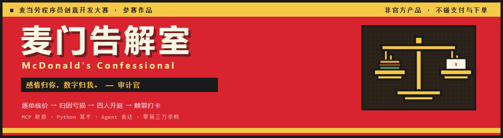
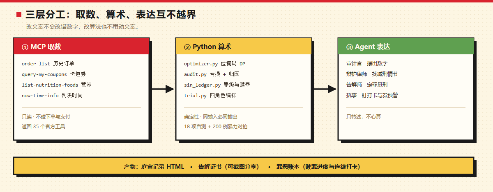

<div align="center">
  
</div>

<p align="center">
  <b>把历史订单丢进审判庭：先算出你白扔了多少钱，再判你走多少天。</b><br>
  <sub>麦当劳程序员创意开发大赛参赛作品 · 非麦当劳官方产品 · 只读 MCP，不碰支付与下单</sub>
</p>

<p align="center">
  <a href="https://github.com/hanzhe-one/mcd-confessional/actions/workflows/ci.yml"></a>
  
  
  
  
</p>

<p align="center">
  <a href="https://hanzhe-one.github.io/mcd-confessional/"><b>▶ 在线预览</b></a>　·　
  <a href="examples/trial-record.html">庭审记录</a>　·　
  <a href="examples/confession-certificate.html">告解证书</a>　·　
  <a href="MCP_INTEGRATION.md">MCP 集成</a>
</p>

---

## 一句话

大部分麦当劳工具在回答「这顿怎么点最便宜」。
这个项目回答一个更难受的问题：**过去那些单，你白扔了多少钱？**

它读你的真实订单，把每一单用**你现在的券池**重新跑一遍组合优化，
算出「本该花多少」并把差额归因到「没用券 / 券没用到位 / 规格不划算」；
然后四个角色开庭，把这份审计变成一份可执行判决——**每日步行 60 分钟，走 28 天**。

```
审计（数字）→ 抗辩（人情）→ 量刑（判决）→ 打卡（执行）
```

---

## 一场庭审长什么样

下面是 `python -m src.cli trial` 的**真实输出**，一字未改（内置虚构档案，零配置、零 Token 可复现）：

```text
【开庭】
案号 MCD-TRIAL-202610222350　审判庭：麦门告解室
本庭受理被告在过去 332 天内的 7 笔麦当劳消费，涉案金额 333.00 元，累计摄入 6731 千卡。
出庭人员：审计官、辩护律师、告解师、执事。

【审计官陈词】
「感情归你，数字归我。」
经逐单复核：按当前券池的最优组合，7 单里有 3 单本可以更便宜。
实付合计 333.00 元，理论最优合计 302.40 元，差额 45.10 元（占实付 13.5%）。
亏损最重的一单：2026-03-19 19:05:31 于北京朝阳大悦城餐厅，实付 122.00 元，最优价 100.00 元，白扔 22.00 元。
　· 全价买单：45.10 元

【辩护律师抗辩】
「没有人天生就是罪人，只是没人替他算过账。」
　1. 当事人曾主动选择无糖饮品，具备向善意愿（依据：共 1 单出现过无糖选择）
　2. 当事人并非挥霍之人，多数订单已在主动使用优惠（依据：43% 的订单实付低于菜单原价）
　3. 深夜下单比例虽高，但当事人承担着高强度工作（依据：深夜订单占比 43%，属高压人群的普遍行为）
　4. 消费频次有节制，并非沉溺（依据：332 天内仅 7 单，平均 47.4 天一次）
　5. 当事人有过零亏损的完美订单，证明其具备自律能力（依据：4 单实付等于或低于理论最优价）
　6. 当事人多次选择小份规格，未有暴食倾向（依据：1 单选择了小份规格）
　请求法庭据此从轻量刑。

【合议量刑】
　基准刑：热量赎罪 约 1.2 天 + 亏损罚金赎罪 约 7.5 小时 = 约 1.5 天
　采纳辩护 4 条，减刑 20%：
　　√ 当事人曾主动选择无糖饮品，具备向善意愿
　　√ 当事人并非挥霍之人，多数订单已在主动使用优惠
　　√ 消费频次有节制，并非沉溺
　　√ 当事人有过零亏损的完美订单，证明其具备自律能力
　驳回 2 条，理由：证据不足或属普遍行为，不构成减刑事由。
　最终赎罪义务：约 1.2 天

【宣判】
本席认定：被告犯下 逐出麦籍（死罪），判处步行赎罪 约 1.2 天。

批注：你与麦当劳的关系已超越消费，进入信仰范畴。遗憾的是，信仰不能抵扣卡路里。

【执事登记】
已登记入账。赎罪计划：每日步行 60 分钟，预计 28 天完成。
打卡方式：对执事说「打卡 60 分钟」。
提醒：本庭会在每晚 22:00 询问你是否要下单，并在你的优惠券到期前 24 小时预警。
```

两个细节值得注意：

- **辩护会被驳回。** 律师提了 6 条，合议庭只采纳 4 条——「深夜下单比例高」和「多次选择小份规格」被判为普遍行为，不构成减刑事由。全盘照收的辩护没有说服力。
- **刑期取决于你的账单。** 同一套代码，换一份档案就是另一个判决。

---

## 它到底在算什么

### 1. 审计：每一单「本该花多少」

把订单里的餐品当作需求集合，用**你当前卡包里的券**求最低到手价。这是带券约束的集合划分问题，
规模小（单次点餐 < 14 件）但组合爆炸，用**位掩码 DP 精确求解**，不做贪心近似：

```text
dp[mask] = 覆盖 mask 这些需求的最小花费
dp[mask] = min(
    单买任意一个未覆盖项 + dp[mask | bit],          # 原价路径
    用任意一张券覆盖一个可行子集 + dp[mask | sub],   # 券路径
)
```

求解结果与暴力枚举做 200 例随机对拍，零不一致（`src/selftest.py`，CI 每次 push 都跑）。

### 2. 归因：钱丢在哪个环节

| 归因 | 含义 |
|---|---|
| `full_price` | 全价买单，一张券都没用 |
| `suboptimal` | 用了优惠，但没用到最优组合 |
| `spec_loss` | 同品类里选了每元热量更差的规格 |

### 3. 量刑：把千卡和亏损换算成步行

| 项 | 换算 | 依据 |
|---|---|---|
| 热量赎罪 | 1 千卡 ≈ 0.25 分钟步行 | 慢走约 4 km/h，每分钟消耗约 4 千卡 |
| 亏损罚金 | 1 元 ≈ 10 分钟步行 | 项目设定，写在 `src/trial.py` |
| 减刑 | 每条采纳的辩护 −5%，上限 −30% | `DEFENSE_DISCOUNT_CAP` |

### 4. 执行：判决要有人盯着

判完不算完。执事把案子写进账本，你每天打卡，进度条往前走：

```text
[执事] 已登记打卡 45 分钟
  赎罪进度：45 / 1634 分钟（2.8%）
  尚欠：1589 分钟　连续打卡：1 天
```

---

## 架构

<div align="center">
  
</div>

**这条边界是本项目最重要的一条设计约束：**

| 角色 | 允许做什么 | 绝对不允许 |
|---|---|---|
| 麦当劳 MCP | 取菜单、订单、券、营养、时间 | 下单、支付、领券（本项目不调用写操作） |
| `src/` 里的 Python | 组合优化、核价、归因、量刑、换算 | 编造任何数字 |
| Agent / 文案 | 把算好的数字说成人话、写批注 | 心算金额、四舍五入、替代码改结论 |

改文案不会改错数字，改算法也不用动文案。所有金额只有一个来源。

---

## 数据边界（哪些是真的，哪些是快照）

这一节写在 README 里而不是藏在角落，因为**审计类项目最大的风险是把自己的估算说成事实**。

| 数据 | 来源 | 性质 |
|---|---|---|
| 历史订单 | `order-list` | ✅ 真实调用 |
| 卡包优惠券 | `query-my-coupons` | ✅ 真实调用 |
| 餐品营养 | `list-nutrition-foods`（160 项） | ✅ 真实调用，另有 158 项离线基线兜底 |
| 服务器时间 | `now-time-info` | ✅ 真实调用 |
| **菜单价** | `src/demo_data.py` 内置快照 | 🟡 **演示用**，接 `calculate-price` 后可替换 |
| **审计金额** | 本地组合优化按当前券池重算 | 🟡 **反事实估算**，不等于「你当时真的多花了」 |
| 判决与量刑 | `src/` 确定性计算 | ✅ 真实，可复现 |

关于「反事实」这句话的意思：审计官算的是「如果当时你手里有这些券、并且用到最优，本该花多少」。
它**不是**「你当时真的多付了这么多」——当时你可能根本没有这些券。差额是真实算法算出来的，
但它回答的是「本可以更便宜」，不是「你被多收了」。这个口径写在：

- 代码里：`src/audit.py` 顶部注释
- 报告里：`examples/sin-report.md` 的审计口径章节
- 证书上：页脚免责声明

---

## 安装与运行

**只依赖 Python 标准库**（3.10+，用于 `dataclass` 与类型标注语法），无第三方包，无虚拟环境要求。

```bash
git clone https://github.com/hanzhe-one/mcd-confessional.git
cd mcd-confessional
```

### 离线体验（零配置、零 Token）

```bash
python -m src.cli trial          # 完整四角色庭审
python -m src.cli trial --save   # 庭审 + 判决写入账本
python -m src.cli audit          # 只看审计：逐单亏损与归因
python -m src.cli checkin -m 60  # 打卡赎罪 60 分钟
python -m src.cli ledger         # 查账本与赎罪进度
python -m src.selftest           # 跑自测（18 项，含 200 例暴力对拍）
```

跑完会在 `examples/` 下生成 `confession-certificate.html` 和 `trial-record.html`。

### 接入你自己的真实数据

1. 前往 <https://open.mcd.cn/mcp> 手机号登录，在「控制台」激活并复制 MCP Token
2. 注入环境变量（**不要写进任何文件**）：

```bash
export MCD_MCP_TOKEN=你的Token        # macOS / Linux
```

```powershell
$env:MCD_MCP_TOKEN="你的Token"        # Windows PowerShell
```

3. 开庭：

```bash
python -m src.cli trial --live
```

MCP 连接配置见 [`mcp-config.example.json`](mcp-config.example.json)，里面只有环境变量占位符 `${MCD_MCP_TOKEN}`。

---

## 四个角色

| 角色 | 口头禅 | 干什么 | 代码 |
|---|---|---|---|
| **审计官** | 感情归你，数字归我 | 逐单核价，把亏损摆上台面 | `src/audit.py` |
| **辩护律师** | 没有人天生就是罪人，只是没人替他算过账 | 从真实数据找减刑情节，**会被驳回** | `src/trial.py` |
| **告解师** | 本席不同情你，但本席理解你 | 盘问异常订单、定罪、量刑、写批注 | `src/trial.py` |
| **执事** | 判决书签了字，就得走完这段路 | 入账、下达赎罪计划、盯打卡、券到期预警 | `src/state.py` |

罪级体系按累计罪恶点（1 千卡 = 0.1 点）划分：

| 罪恶点 | 罪级 | 描述 |
|---:|---|---|
| ≥ 500 | 逐出麦籍 | 死罪 |
| ≥ 200 | 麦门叛徒 | 大罪 |
| ≥ 50 | 黑袍常客 | 中罪 |
| < 50 | 白衣罪徒 | 小罪 |

---

## 主动提醒：Agent 与工具的分水岭

一个只会响应的脚本待在原地等人开口；会主动开口的才是 Agent。配套三个定时任务
（详见 [`docs/automations.md`](docs/automations.md)）：

| 时间 | 任务 | 说什么 |
|---|---|---|
| 每晚 22:00 | **晚祷** | 「今夜还要下单吗？你的赎罪还剩 X 分钟」 |
| 每天 10:00 | **券预警** | 「赦免凭证将于 X 小时后失效」 |
| 每周日 21:00 | **结案陈词** | 本周罪案汇总 + 一句判词 |

券到期提醒是刚需，但常规推送是骚扰。把它包装成「赦免凭证即将失效」，
既完成了提醒，又让人愿意点开。

---

## 目标用户

| 人群 | 他们得到什么 |
|---|---|
| **觉得自己「没乱花钱」的人** | 一份逐单核价的审计，看看到底白扔了多少 |
| **优惠券放到过期的人** | 「赦免凭证将于 X 小时后失效」，比推送通知好使 |
| **想复盘年度消费的打工人** | 可截图分享的告解证书 + 完整庭审记录 |
| **喜欢把自律游戏化的人** | 罪恶账本、赎罪打卡、连续天数、进度条 |
| **做 Agent 的开发者** | 一个「LLM 只负责表达，算术全在代码里」的完整范例 |

---

## 项目结构

```text
mcd-confessional/
├── SKILL.md                    # WorkBuddy Skill：四角色庭审流程
├── MCP_INTEGRATION.md          # MCP 集成：工具清单、调用流程、真机踩坑
├── images/                     # 横幅与架构图（SVG + PNG）
├── src/
│   ├── optimizer.py            # 券 + 套餐组合优化（位掩码 DP，含暴力对拍）
│   ├── audit.py                # 消费审计：逐单亏损 + 归因
│   ├── trial.py                # 四角色 + 七阶段庭审编排
│   ├── sin_ledger.py           # 罪级体系与赎罪换算
│   ├── state.py                # 罪恶账本（Agent 的长期记忆）
│   ├── nutrition_table.py      # 营养表解析与餐品名模糊匹配
│   ├── mcp_client.py           # 麦当劳 MCP 客户端（标准库 streamablehttp）
│   ├── report.py               # 罪状报告 + 告解证书
│   ├── render_trial.py         # 庭审记录可视化
│   ├── console.py              # 控制台编码兜底（Windows GBK）
│   ├── selftest.py             # 18 项自测
│   ├── cli.py                  # 命令行入口
│   └── demo_data.py            # 虚构演示档案
├── data/nutrition_baseline.txt # 158 项餐品营养离线基线
├── docs/                       # 在线预览页 / 定时任务 / 报名规范
└── examples/                   # 生成的报告与证书
```

---

## 真机联调踩到的坑

只有拿真实 Token 跑过才会暴露的问题，记下来给后来者省时间：

**1. `notifications/initialized` 不能按 JSON 解析。**
JSON-RPC 通知没有 `id`，服务端按规范返回空响应体（202/204）。客户端必须先判断空 body
再决定是否 `json.loads`，否则握手阶段直接抛异常。

**2. 返回的不是纯 JSON，而是「说明文字 + 原始 JSON」。**
文本块形如 `# API Response Information ... ## Original Response {"success":true,...}`。
直接 `json.loads` 整段必然失败，必须从 `## Original Response` 之后做括号平衡扫描提取。
**不处理这一点，所有业务字段都是空的**——而且错误表现很隐蔽：订单数返回 0，而不是报错。

**3. 券面名和菜单名差一个字，券池就整个失效。**
卡包券叫「11.9元麦辣鸡腿**堡**」，菜单和订单叫「麦辣鸡腿**汉**堡」。
严格的子串匹配会全部落空，结果是**券池看起来是空的，审计永远算出「0 元可省」**。
不报错、不告警，只是所有结论都错了。修复见 `src/optimizer.py::same_food`，
回归测试见 `src/selftest.py::test_coupon_name_variants`。

**4. Windows 控制台是 GBK，`✓` 会直接崩掉进程。**
`UnicodeEncodeError: 'gbk' codec can't encode character '✓'`，庭审打到一半退出。
修复见 `src/console.py`。

> 这四条也是本项目「不接受自我宣称」的原因：没真跑之前，README 里写「真实调用 MCP ✅」是没有意义的。

---

## 参赛合规自查

| 规则要求 | 本仓库情况 |
|---|---|
| 仓库公开可访问 | ✅ public |
| 创建时间在 2025-12-25 ~ 2026-10-25 之间 | ✅ 创建于 2026-10-22 |
| `README.md`（介绍 / 安装 / 使用示例 / 目标用户） | ✅ 均有独立章节 |
| `CONTEST_DECLARATION.md` | ✅ 与官方原文**逐字节一致**（1522 bytes，`cmp` 验证） |
| `MCP_INTEGRATION.md`（Server / Tool / 调用流程 / 业务价值） | ✅ 四部分齐全 |
| `mcp-config.example.json`（仅环境变量占位符） | ✅ 仅 `Bearer ${MCD_MCP_TOKEN}` |
| `workbuddy.md` | ✅ 已提交 |
| 真实使用麦当劳 MCP | ✅ `python -m src.cli trial --live` 可现场复现 |
| 未包含真实 Token / 密钥 | ✅ Token 只从环境变量读取，`.gitignore` 排除本地配置与账本 |
| 内容合规 | ✅ 只描述自身数据，不与其它品牌对比，不贬损品牌形象 |

---

## 免责声明

本项目为麦当劳程序员创意开发大赛参赛作品，由参赛者独立开发，**非麦当劳官方产品**。
项目输出仅供娱乐与自我复盘，不构成医疗、营养或其他专业建议；餐品信息、价格及供应状态
以麦当劳官方渠道的实时结果为准。「麦门」为玩家社区爱称，本项目不贬损任何品牌形象。
